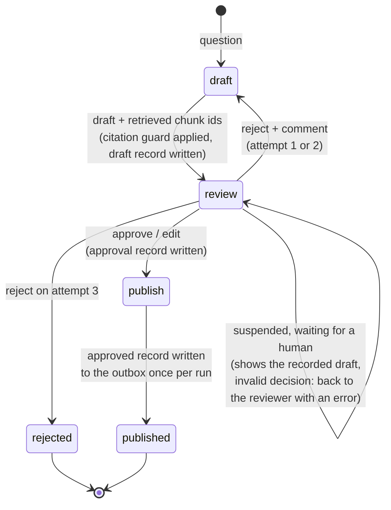

# durable-review-workflow

A cited-answer workflow on [Mastra](https://mastra.ai) 1.x that waits for a human before it publishes and survives being killed at any step boundary. The scenario: a question about the EU AI Act (66 verbatim paragraphs), a drafted answer with chunk citations, an approve / reject-with-comment / edit decision, and only then a write to a local outbox.

The repo measures four claims instead of asserting them: crash recovery at every step boundary, idempotent publish, a review gate that cannot be skipped, and a bounded reject-and-redraft loop. It also measures where the claims break without extra work, because that is the part a framework does not do for you.

## Quickstart

```bash
bun install
bun run check          # typecheck + tests, no model needed (includes a real SIGKILL test)
bun run crash          # full crash matrix with the fixture drafter, about 5 min, mostly lease waits
```

With a local model (Ollama with `qwen3:8b` and `bge-m3`):

```bash
DRAFTER=ollama bun run live    # 10 golden questions end to end, one reject loop
DRAFTER=ollama bun run crash   # same crash matrix, drafts written by the model
```

Drive one run by hand with the same process the crash harness uses. Run it, kill it, run it again:

```bash
bun scripts/driver.ts data/demo run-1 reject-then-approve "Wann entfällt die Pflicht, Personen über die Interaktion mit einem KI-System zu informieren?"
```

Environment: `DRAFTER=fixture|ollama`, `PUBLISH_MODE=idempotent|naive`, `MASTRA_AGENT_THREAD_LEASE_TTL_MS` (Mastra's run-ownership lease, default 15000). Typos in the first two throw instead of picking a default.

## Architecture



- **draft** (`src/workflow.ts`) pins the question on the first attempt and calls a drafter: a deterministic fixture that cites each golden case's expected chunks, or `qwen3:8b` with the source repo's v2 prompt and a `search-regulation` tool over bge-m3 vectors. The citation guard rule from the source repo runs on every draft: an answer citing a chunk that was not retrieved in this run, or citing nothing without being a refusal, is replaced by the `[KEINE_GRUNDLAGE]` fallback. The step records question, draft and retrieved chunk ids, once per attempt; a rerun returns the recorded draft instead of drafting again.
- **review** suspends with the draft as the draft step recorded it. It accepts exactly `{decision: "approve"}`, `{decision: "reject", comment}` or `{decision: "edit", text}`. An edit must still pass the citation rule against what was retrieved. On approve or edit it records the approved question and text.
- **draft + review** form a nested workflow inside `dountil`, so a reject loops back to a new draft with the reviewer's comment and the previous draft in the prompt, at most 3 drafts.
- **publish** takes question and text from the approval record, not from its input, and writes the message to `outbox/messages/<runId>.json` with `link(2)`, which is atomic and fails if the key exists. A rerun finds the file and returns `firstWrite: false`.
- **Storage** is LibSQL (`data/<run>/mastra.db`). Every process builds its own Mastra instance on the same file.

The crash harness (`scripts/crash-matrix.ts`) starts `scripts/driver.ts` as a child process with `KILL_AT=<point>`. At that point the child prints `KILLPOINT` and waits; the harness sends SIGKILL, so nothing in the child can flush or clean up. A fresh driver process then reads the run from storage and continues: `run.restart()` for a run caught mid-step, `run.resume()` for a suspended one.

## Results

All numbers below come from files in `results/`. Run date 2026-11-09, Mastra core 1.82.0, LibSQL store 1.29.0, Bun 1.4.2, macOS arm64.

### Crash recovery (`results/crash-matrix-fixture.json`)

12 cases per publish mode: SIGKILL at 11 points across both review scenarios, plus one stalled process (SIGSTOP past its lease, a second process recovers the run, then the first resumes).

| kill point | scenario | idempotent outbox | naive outbox |
|---|---|---|---|
| `draft:start#1` | approve | ✅ 1 | 1 |
| `draft:end#1` | approve | ✅ 1 | 1 |
| `waiting#1` (suspended, process gone) | approve | ✅ 1 | 1 |
| `review:resumed#1` | approve | ✅ 1 | 1 |
| `publish:before-write` | approve | ✅ 1 | 1 |
| `publish:after-write` | approve | ✅ 1 | ❌ 2 |
| `review:resumed#1` (the reject) | reject → approve | ✅ 1 | 1 |
| `draft:start#2` | reject → approve | ✅ 1 | 1 |
| `draft:end#2` | reject → approve | ✅ 1 | 1 |
| `waiting#2` | reject → approve | ✅ 1 | 1 |
| `publish:after-write` | reject → approve | ✅ 1 | ❌ 2 |
| `publish:before-write`, stalled not killed | approve | ✅ 1 | ❌ 2 |

- **Idempotent: 12 of 12 kill points recovered to `success` with exactly one outbox message.** No message lost, none duplicated. After the kill at `publish:after-write` the rerun publish found the existing file (`firstWrite: false`).
- **Naive (append without a key): 3 of 12 duplicated**, exactly where the write had happened but Mastra had not yet recorded the step as done, and in the stalled case. This is the control: it shows that Mastra re-executes a step it has no completion record for, which is correct behaviour, and that the side effect is therefore yours to make idempotent.
- **Recovery is not instant.** A run killed mid-step stays `running` in storage, and the dead process still holds Mastra's run-ownership lease. `run.restart()` refuses with `WORKFLOW_RESTART_RUN_OWNED` until the lease expires; the driver waits it out. Measured wait: 14.9 to 15.0 s across the 20 cases that had to take over a run left `running` (9 kills mid-step and 1 stall per mode), against the 15 s default TTL. A run killed while suspended needs no wait (`waiting#1`, `waiting#2`).
- **The lease does not fence writes.** In the stalled case both processes executed `publish`. Only the idempotent outbox kept it to one message.

The same matrix with qwen3:8b writing the drafts (`results/crash-matrix-ollama.json`) gave the same picture: idempotent 12 of 12, naive 3 duplicates at the same three points. Lease waits there were 11.4 to 15.0 s, shorter because part of the lease had already run out while the model was drafting. In none of its 10 reject cases did the published text pick up the reviewer's wording; the redraft happened every time (2 attempts), so the matrix counts it as recovered.

### Review gate (`results/gate-bypass.json`)

18 attempts to get past the review step, run with the gate checks on and off. "Off" makes review and publish trust their input again, which leaves only Mastra's suspend between draft and publish; the draft step keeps its write-once records in both columns. "Forged" means content that came from the caller (a made-up text, a made-up question, another run's record) reached the outbox.

| attempt | records on | records off |
|---|---|---|
| 6 invalid resume payloads (none, `{}`, unknown decision, reject without or with blank comment, approve with smuggled text) | ✅ blocked, run still resumable | ✅ blocked |
| `resume({ step: "publish" })` | ✅ blocked (step not suspended) | ✅ blocked |
| `timeTravel` to publish on a fresh run | ✅ blocked (no approval) | ❌ forged |
| `timeTravel` to publish with a forged `draft-and-review` result in `context` | ✅ blocked (no approval) | ❌ forged |
| `timeTravel` to publish after a real approval, different text | ✅ only the approved message (already in the outbox) | ✅ blocked, but only by the outbox key |
| `timeTravel` to publish on a run named `<other run>.draft.1` | ✅ blocked (records keyed by kind and run) | ❌ forged |
| `timeTravel` into `draft-and-review.review` with a forged draft and `resumeData: approve`, dot path | ⚠️ published the recorded draft, not the forged one | ❌ forged |
| the same, array path `["draft-and-review", "review"]` | ⚠️ published the recorded draft | ❌ forged |
| `timeTravel` into review with a forged draft, then a human approves what they are shown | ⚠️ the human was shown and approved the recorded draft | ❌ forged |
| `timeTravel` into review, real draft under a forged question, `resumeData: approve` | ⚠️ published the recorded draft under the real question | ❌ forged |
| `timeTravel` into draft with a forged question, then the reviewer approves | ⚠️ draft step returned the recorded draft; the reviewer approved that | ⚠️ same (draft records stay on) |
| `timeTravel` into draft for attempt 2 with a forged comment, no rejection | ✅ blocked (no rejection record) | ✅ blocked (same) |
| `timeTravel` into review on a fresh run | ✅ blocked (Mastra input validation) | ✅ blocked (Mastra input validation) |

- **With the checks: 0 of 18 attempts got caller content into the outbox.** Without them, 7 of 18 did, 6 of those with no human involved. Suspend stops the normal path; it does not stop a caller who can reach `run.timeTravel`, which runs any step, nested ones included, with caller-supplied input.
- **The ⚠️ rows are approvals, not bypasses, and they are the remaining boundary.** `timeTravel` with `resumeData: { decision: "approve" }` approves the recorded draft exactly as `resume` would. Whoever can call either is a reviewer. Keep both behind the same access control.
- **How it works** (`src/approvals.ts`): no step takes content from its input; content travels through records, each written by one step. The question is pinned once per run. The draft step writes one draft per attempt, write-once, and returns the existing one on any rerun, so a draft a reviewer has seen cannot change under them. A rejection records the reviewer's comment, and the next draft reads comment and previous draft from the records. Review shows and approves only the recorded draft and takes nothing but the attempt number from its input. Publish writes only the approval record.
- **What earlier versions got wrong**, each found by an independent code review and then reproduced with `gate-bypass.ts`:
  1. The first version checked only at publish (a hash of the approved text). Time-travelling into the review step minted a valid approval for a forged draft.
  2. The fix bound approvals to a draft-record hash, but draft and approval records shared one key space: a run named `x.draft.1` could present run `x`'s draft record as its approval. Against that version, 1 of 15 attempts published with the checks on (`results/gate-bypass-shared-keys.json`). Records are now named by a hash of kind, run and attempt and checked for both on read.
  3. The draft hash still left the question unbound: a real draft could be approved under a forged question. Instead of hashing one more field, review and publish stopped reading content from their input at all.
  4. The draft step itself still took question and comment from its input and overwrote its record, so a time-travelled draft could replace one a reviewer had already seen. The same overwrite would have hit a stalled drafter waking up after recovery. Question, drafts and rejections are now write-once records.
- A separate mistake: the strict decision schema first sat on Mastra's `resumeSchema`. An invalid payload then failed validation and moved the whole run to `failed`, from which it cannot be resumed, so one reviewer typo threw the draft away. The review step now takes a permissive resume schema, validates the decision itself and suspends again with an error.

### Tests (`results/tests.junit.xml`)

`bun run check`: 30 tests, 0 failures (`bun run report:tests` writes the file). Includes the gate attempts above, the reject loop (comment reaches the drafter; after 3 rejections the run ends `rejected` with nothing published), edits (an edit citing an unretrieved chunk goes back to the reviewer), the citation guard on drafts, a second Mastra instance resuming a suspended run, five idempotent publish retries giving one message, and one real SIGKILL/recover cycle per publish mode.

### With the model (`results/live-ollama.json`, earlier repeats `live-ollama-run1.json`, `live-ollama-run2.json`)

qwen3:8b, temperature 0, think off, the source repo's v2 prompt. 10 golden questions (6 from the tuning set, 4 held out), scripted reviewer approves, one case is rejected once with a comment. Three runs: `live-ollama.json` with the final code, the two repeats before the gate records were added (same drafting, recovery and publish code). Same outcomes in all three.

- **10 of 10 runs finished and published exactly once**, in every run. The citation guard replaced 0 of 11 drafts.
- **8 of 10 answered-or-refused correctly.** Both misses are held-out questions (`h-a99-midcap`, `h-a113-art102`) where the model refused in under a second, apparently without searching. Same two in all three runs.
- **The reject loop worked mechanically and did nothing for quality.** The reviewer asked for the condition under which the duty lapses. In two runs the redraft was word for word the first draft; in the third it only gained the prefix "Der neue Entwurf lautet:". The comment reaches the prompt (the fixture tests prove the plumbing); an 8B model at temperature 0 ignored it. Bounded retries matter for exactly this reason.
- Time per answered case: 7.2 to 26.6 s across the three runs (the upper end is the reject case, two drafts), dominated by the model.

## What Mastra workflows give you and what they don't

**What you get**

- **Persisted step results and suspend/resume across processes.** A suspended run survives the process that started it; any later process with the same storage resumes it with `run.resume({ resumeData })`. Measured: every `waiting#*` kill recovered.
- **Recovery of runs caught mid-step.** `run.restart()` re-executes from the last step without a completion record. Steps that finished are not rerun. Measured: all 9 mid-step kill points per mode recovered.
- **Loops with suspension inside.** A nested workflow in `dountil` suspends per iteration, and resume finds the right iteration.
- **A run-ownership lease** that keeps a second process from restarting a run that is still alive and renewing.
- **Schema validation** of step inputs, outputs, suspend and resume payloads.

**What stays your job**

- **Exactly-once side effects.** Recovery is at-least-once per step: a step that wrote and then died runs again. Measured: a plain append duplicated in 3 of 12 cases. Key every side effect by something stable (here the run id) and make the write itself idempotent (here `link(2)`, which fails if the key exists).
- **Fencing.** The lease marks ownership; it does not stop a stalled owner from writing after it lost the lease. The idempotent write is what saved the stalled case.
- **The gate itself.** Suspend pauses the normal path. `run.timeTravel` runs any step with caller-supplied input, so a step must not take content from its input once a gate depends on it: here every step after draft reads content only from records written by the step before it. Measured: caller content reached the outbox in 7 of 18 attempts without the checks, 0 with them.
- **Who approves.** Anyone who can call `resume`, or `timeTravel` with `resumeData`, can approve. Authenticating the reviewer is outside the workflow.
- **Failure handling for bad human input.** A payload rejected by `resumeSchema` fails the run permanently. Validate in the step if a typo should not cost the draft.
- **Recovery orchestration.** Nothing restarts a crashed run by itself here: a process has to find `running` runs (`listActiveWorkflowRuns`, or Mastra's boot-time `restartAllActiveWorkflowRuns`), and it has to wait out the lease (15 s default, `MASTRA_AGENT_THREAD_LEASE_TTL_MS`).
- **Quality of what the loop produces.** The redraft loop is plumbing. Whether a comment changes the draft depends on the model (it did not, above).

## Layout

```
corpus/chunks.json      66 paragraphs of the EU AI Act (copied, unchanged)
golden/                 40 + 8 questions with expected chunks (copied, unchanged)
src/grading.ts          citation and refusal rules (copied, unchanged)
src/instructions.ts     prompt versions (copied, import path adjusted)
src/workflow.ts         steps, guard, gate, loop
src/approvals.ts        question, draft, rejection and approval records (one writer each)
src/outbox.ts           idempotent and naive publish
src/killpoint.ts        crash injection points
scripts/driver.ts       one reviewer process; rerun it after a crash
scripts/crash-matrix.ts SIGKILL at every boundary, both publish modes
scripts/live.ts         end-to-end run with qwen3:8b
scripts/gate-bypass.ts  every known way past the review step, checks on and off
results/                measured numbers; everything in this README comes from here
```

License: Apache-2.0.
